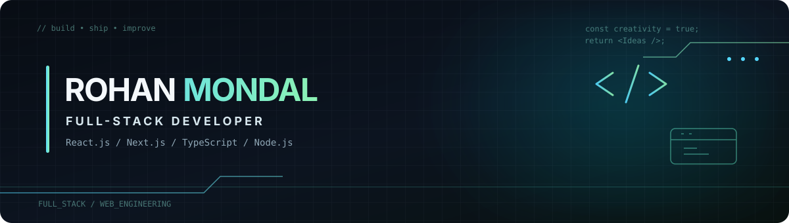

<!-- Profile README for rohan654321/rohan654321 -->

  
   
  
  

## `whoami` → Rohan Mondal

Full-stack developer focused on building thoughtful, responsive web products — from polished interfaces and motion-rich experiences to practical admin workflows and data-backed applications.

I enjoy turning designs into maintainable React interfaces, connecting them to backend services, and improving the details that make a product feel complete.

## `toolbox` / what I work with

<table>
  <tr><td><strong>Frontend</strong></td><td>    </td></tr>
  <tr><td><strong>Backend & data</strong></td><td>   </td></tr>
  <tr><td><strong>Motion & 3D</strong></td><td>  </td></tr>
</table>

## `selected_work` / projects

<table>
  <tr>
    <td width="50%" valign="top">
      <h3>01 · Tooling Frontend</h3>
      Admin-facing workflows for managing directories, companies, events, and content.  
      Next.js · React · TypeScript  
      <a href="https://github.com/rohan654321/tooling-frontend">View repository →</a>
    </td>
    <td width="50%" valign="top">
      <h3>02 · BizTrades App</h3>
      Business and event-oriented workflows spanning organizers, attendees, venues, and exhibitors.  
      Next.js · React · Prisma  
      <a href="https://github.com/rohan654321/biztrades-app">View repository →</a>
    </td>
  </tr>
  <tr>
    <td width="50%" valign="top">
      <h3>03 · Laundrica</h3>
      A motion-led web experience exploring interactive visuals and 3D elements.  
      Next.js · TypeScript · Three.js · Framer Motion  
      <a href="https://github.com/rohan654321/laundrica">View repository →</a>
    </td>
    <td width="50%" valign="top">
      <h3>04 · Portfolio Website</h3>
      Personal portfolio source with sections for projects, skills, experience, and contact.  
      Next.js · React · TypeScript · Tailwind CSS  
      <a href="https://github.com/rohan654321/portfoliowebsite">View repository →</a>
    </td>
  </tr>
</table>

## `currently_care_about`

- Building responsive UI that stays clear and usable across screen sizes.
- Keeping components reusable and codebases easier to maintain.
- Connecting frontend experiences with reliable APIs and data workflows.
- Adding motion and visual polish when it helps the product, not just the animation.

## `connect()`

Interested in full-stack development and building useful web products.

  <a href="https://www.linkedin.com/in/rohan-mondal-aa3a201a2/">LinkedIn ↗</a> &nbsp;·&nbsp;
  <a href="https://github.com/rohan654321">GitHub ↗</a>

